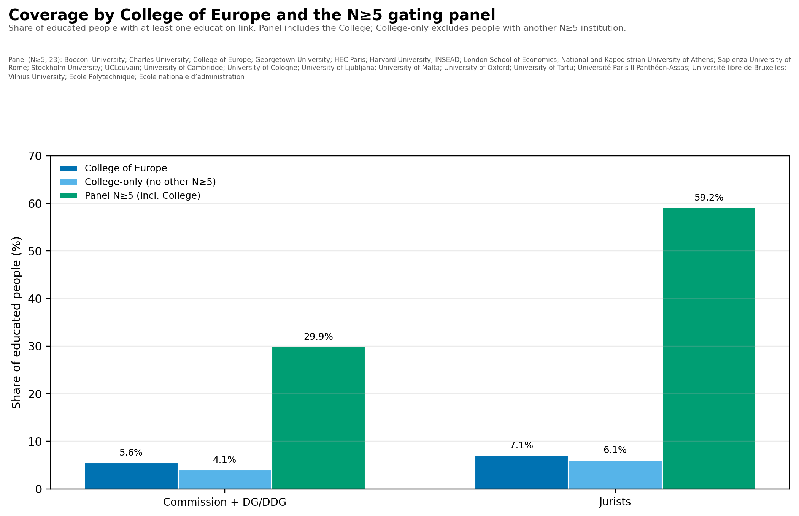
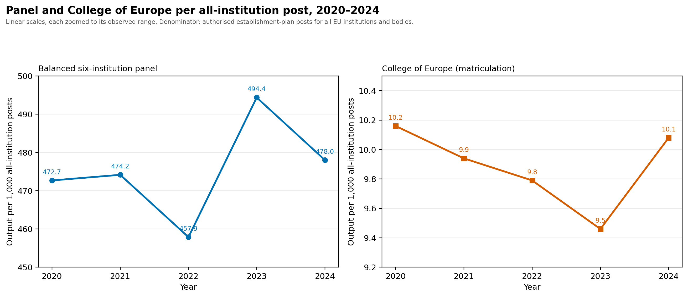
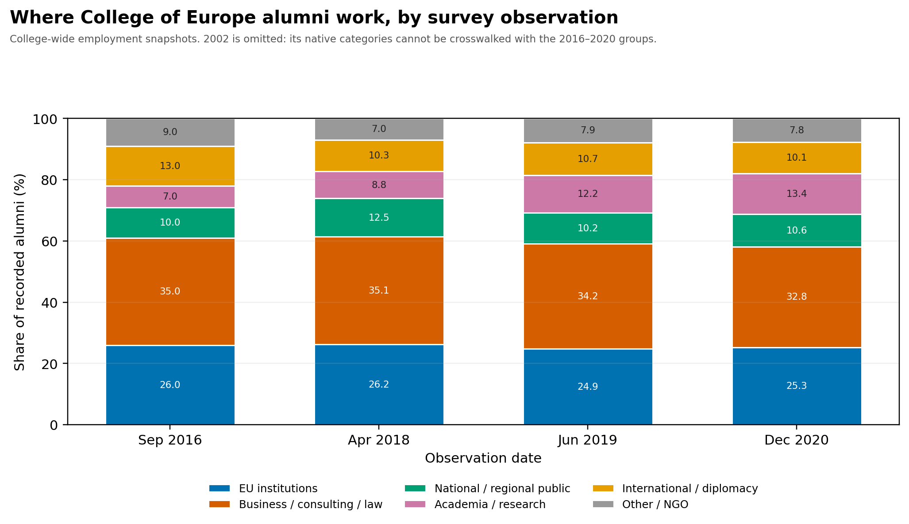

## Who is the European elite?

- There is no single, coherent “European elite.”
- Commissioners, Directors-General, corporate directors, judges and MEPs are different populations with different recruitment.
- We therefore study a narrow, testable core: **Commission + DG/DDG** and **EU jurists**.
- This is a choice of elite *positions*, not a claim that all power lies there.

## National versus supranational elites

- European integration creates competing recruitment orders: national administrations and parties versus EU institutions and law.
- The question is whether these are separate pipelines or one shared gate.
- Education coverage is strong for the chosen core:
    - Commissioners: **79%**
    - DGs/DDGs: **92%**
    - Jurists: **100%**
- Corporate education coverage is only **6%**, so corporate elites are not used for this comparison.

## Why Commission + DG/DDG and jurists?

- They are **EU-level positions**, not national offices.
- They sit on opposite sides of the institutional divide: political-administrative versus legal.
- Their biographies are unusually well documented.
- If a European gating structure exists, it should be visible here first.
- This is an operational test, not a complete theory of European power.

## Gating institutions? A 23-institution panel

- Narrow definition: institutions repeatedly present among educated elite people.
- Presence is measurable; necessity and causation are not.
- Panel = every institution with **at least five** educated elite people: **N ≥ 5**, 23 institutions.
- Largest: College of Europe (18), Harvard (14), Cambridge (10), ENA (10).
- Panel coverage: **29.9%** of Commission + DG/DDG; **59.2%** of jurists.

## College of Europe: a real but minority gate

- Largest single institution in the elite-education table: 18 people.
- 3 commissioners, 8 DGs/DDGs, 7 jurists, no observed corporate track.
- Covers **5.6%** of Commission + DG/DDG and **7.1%** of jurists.
- It is a genuine European pipeline, but not a standalone gateway.
- Its own alumni surveys show roughly **25%** in EU institutions and another **10–13%** in national/regional public administration.

{width=90%}

## Stability relative to bureaucracy size

- All-institution establishment posts: **47,151 → 49,028** (2020–2024), **+4.0%**.
- Panel output per 1,000 posts: **473 → 478**.
- College output per 1,000 posts: **10.2 → 10.1**.
- The bureaucracy grew; gating output did not expand relative to it.

{width=95%}

## Where College of Europe alumni work

- EU institutions remain stable at roughly **25–26%**.
- National/regional public administration: **10–12.5%**.
- Business, consulting and law form the largest block: **33–35%**.
- Academia/research rose from **7%** to **13%**.
- 2002 is omitted: its native categories cannot be crosswalked.

{width=95%}

## Not a lot of elite overproduction at the European level

- The long output series do not show a uniform expansion.
- Relative to the total EU institutional bureaucracy, panel and College output are **flat**.
- Gating is real but **plural**: 23 institutions, not one school.
- The College of Europe is a meaningful but minority pipeline.
- This is descriptive: no unemployment, rejection or cohort-placement data.
- The evidence supports **stability**, not a demonstrated overproduction crisis.

## Appendix: the N ≥ 5 panel

- Bocconi University
- Charles University
- College of Europe
- Georgetown University
- HEC Paris
- Harvard University
- INSEAD
- London School of Economics
- National and Kapodistrian University of Athens
- Sapienza University of Rome
- Stockholm University
- UCLouvain
- University of Cambridge
- University of Cologne
- University of Ljubljana
- University of Malta
- University of Oxford
- University of Tartu
- Université Paris II Panthéon-Assas
- Université libre de Bruxelles
- Vilnius University
- École Polytechnique
- École nationale d’administration
